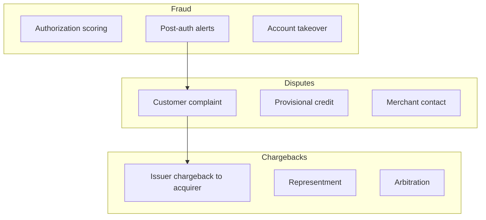

# Domain Overview — Card Fraud & Chargebacks

## 1. Three Related Domains

| Domain | Trigger | Owner | Scheme Rules |
|--------|---------|-------|--------------|
| **Fraud** | Model/rules — no customer action | Fraud Ops | N/A (internal policy) |
| **Dispute** | Customer claims issue | Customer Service | Internal SLA |
| **Chargeback** | Formal scheme dispute | Disputes team | Visa/MC reason codes & timelines |

## 2. Key Metrics

| Metric | Industry Benchmark | Target |
|--------|-------------------|--------|
| Fraud loss rate (bps) | 4–8 bps | < 5 bps |
| False positive rate | 40–60% | < 45% |
| Chargeback ratio | < 0.9% (Visa VAMP) | < 0.75% |
| Representment win rate | 40–55% | > 50% |
| Dispute resolution SLA | — | 10 business days |

## 3. Reason Code Examples (Issuer Perspective)

| Code Family | Example | Typical Evidence |
|-------------|---------|------------------|
| Fraud | 10.4 — CNP fraud | AVS/CVV, 3DS, delivery proof |
| Service | 13.1 — Merchandise not received | Tracking, customer comms |
| Processing | 12.6 — Duplicate processing | Two auth IDs, settlement records |

## 4. Systems Landscape

- **Authorization platform** — real-time fraud rules
- **Case management** — disputes and chargebacks
- **Scheme portals** — Visa Resolve Online, Mastercom
- **Core/card processor** — ledger, provisional credit
