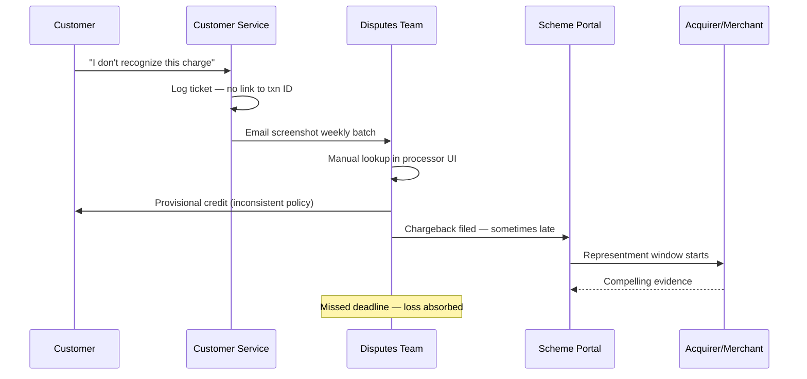

# As-Is Process — Disputes & Chargebacks

## Pain Points

| ID | Issue | Cost Driver |
|----|-------|-------------|
| PP-F01 | CS cannot see fraud score at contact | Wrong provisional credit decisions |
| PP-F02 | Chargeback deadlines tracked in spreadsheet | 12% missed filing window |
| PP-F03 | No unified case ID across CS and Disputes | Customer repeat contacts |
| PP-F04 | Representment evidence gathered manually | Low win rate (38%) |

## Root Cause — Missed Deadlines

Disputes team receives incomplete txn data from CS → rework delays filing past **120-day** issuer window for many fraud reason codes.
