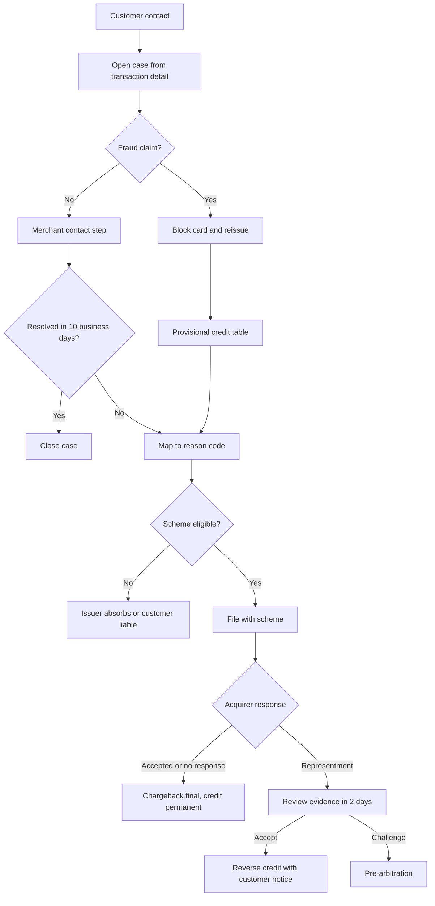

# To-Be Process Design: CardGuard Disputes v1

Issuer perspective. Extends the [BRD](03-business-requirements-document.md). The approved BRD stays as the baseline; the change requests below record gaps found during requirements review.

## 1. Requirements Review Findings

| ID | Finding | Evidence | Resolution |
|----|---------|----------|------------|
| F-01 | Manual review paths have no time limit, while PSD2 Article 73 expects unauthorized transactions to be refunded by the end of the next business day, unless there are reasonable grounds to suspect fraud by the payer | BR-DISP-01 | CR-01 adds a D+1 limit |
| F-02 | No rule for a fraud claim on a transaction of 60 days or older, or where 3DS shifted liability to the issuer | BR-DISP-01 | CR-02 completes the decision table |
| F-03 | Rows overlap: a customer with 3+ disputes can also meet the auto credit row | BR-DISP-01 | CR-03 sets row precedence |
| F-04 | A T-3 alert can land on a weekend, when nobody reads it | BR-CB-01 | CR-04 moves it to the prior business day |
| F-05 | The objective of +10 points on a 38% baseline gives 48%, but the KPI target says above 50% | BRD section 1, PP-F04, Domain Overview | CR-05 sets 48% for year 1, 50% for year 2 |
| F-06 | Monitoring program thresholds are written as a fixed benchmark, but schemes revise them | Domain Overview section 2 | CR-06 moves them to configuration |

## 2. Change Requests

| CR | Rule | Statement |
|----|------|-----------|
| CR-01 | BR-DISP-02 | For an unauthorized transaction claim, the credit decision SHALL be made by the end of the next business day. A refusal based on suspected fraud by the payer SHALL be recorded with reason and approver. |
| CR-02 | BR-DISP-01 (amended) | See the decision table in section 3. |
| CR-03 | BR-DISP-01 (amended) | Rows SHALL be evaluated in order, and the first match applies. |
| CR-04 | BR-CB-02 | An alert date that falls on a non-working day SHALL move to the prior business day. |
| CR-05 | Objective | Representment win rate target: 48% at 12 months, 50% at 24 months. |
| CR-06 | FR-09 (Must) | Scheme deadlines and monitoring thresholds SHALL be held as dated configuration, owned by Scheme Compliance. |

## 3. Provisional Credit Decision Table

| Order | Claim | Conditions | Outcome |
|-------|-------|------------|---------|
| 1 | Any | 3+ disputes in 12 months | Manual review, D+1 for fraud claims |
| 2 | Fraud | Amount above EUR 500 | Fraud Ops approval within 4h |
| 3 | Fraud | Amount up to and including EUR 500, no 3DS authentication, under 60 days | Auto credit |
| 4 | Fraud | 3DS authenticated | Manual review, D+1, chargeback likely not available |
| 5 | Fraud | 60 days or older | Manual review, D+1 |
| 6 | Non-fraud | Any | No auto credit, merchant contact first |

## 4. To-Be Case Flow

## 5. Scheme Reference

Typical values, held as configuration. The current rulebook always takes precedence.

| Stage | Visa | Mastercard |
|-------|------|------------|
| Portal | Visa Resolve Online | Mastercom |
| First dispute or chargeback | Up to 120 days from processing date | Up to 120 days |
| Acquirer response | 30 days | 45 days (second presentment) |
| Pre-arbitration | 30 days | 45 days |

| Dispute type | Visa code | Mastercard code | Visa workflow |
|--------------|-----------|-----------------|---------------|
| CNP fraud | 10.4 | 4837 | Allocation |
| Duplicate processing | 12.6 | 4834 | Collaboration |
| Goods not received | 13.1 | 4853 | Collaboration |

Allocation means that the scheme assigns liability from reported fraud and rule checks; collaboration means that the merchant responds before a liability outcome.

## 6. Evidence Checklist (FR-04)

| Code | Evidence the issuer expects to review | Why it matters |
|------|---------------------------------------|----------------|
| 10.4 | Fraud report submitted, 3DS result, AVS and CVV result | Determines liability |
| 10.4 | Compelling Evidence 3.0: two prior undisputed transactions, 120 to 365 days old, matching on at least two data elements, one of them IP or device | A valid package can defeat the claim |
| 12.6 | Both transaction IDs, amounts, settlement records | Proves a true duplicate |
| 13.1 | Expected delivery date, tracking result, customer contact attempt | Tests whether goods arrived |
