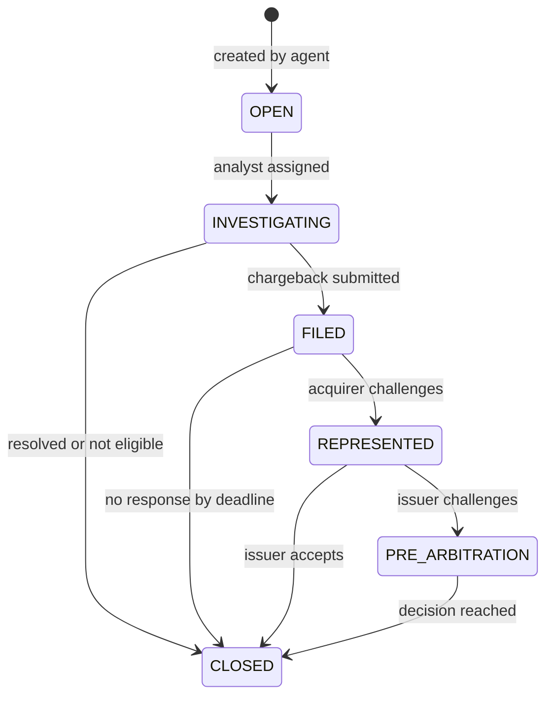

# Data Requirements and Test Plan: Fraud & Chargebacks

## 1. Dispute Case Record

| Field | Type | Mandatory | Rule |
|-------|------|-----------|------|
| `caseId` | String | Yes | Given to customer at first contact |
| `transactionId` | String | Yes | Links to processor record (FR-01) |
| `disputeType` | Enum | Yes | FRAUD_CNP, FRAUD_CP, NOT_RECEIVED, DUPLICATE, NOT_AS_DESCRIBED |
| `contactChannel` | Enum | Yes | PHONE, APP, CHAT, BRANCH |
| `customerStatement` | Text | Yes | Free text with structured prompts |
| `disputedAmount` | Decimal | Yes | Up to the transaction amount |
| `fraudScore` / `ruleHits` | Number / List | When available | Read-only for customer service (FR-08) |
| `scaResult` | Enum | CNP | AUTHENTICATED, NOT_AUTHENTICATED, EXEMPT |
| `pcAmount` / `pcStatus` | Decimal / Enum | If credited | POSTED, MADE_PERMANENT, REVERSED |
| `pcDecisionDueAt` | Timestamp | Fraud claims | End of next business day |
| `reasonCode` | String | Before filing | Scheme specific |
| `schemeDeadlineAt` | Date | Before filing | From dated configuration |
| `representmentReceivedAt` | Timestamp | If received | Starts 2-day review |
| `outcome` | Enum | On closure | WON, LOST, ACCEPTED, WITHDRAWN, NOT_ELIGIBLE |

## 2. Case Status Model

## 3. Fraud Alert Triage

Fixes the false-positive problem named in the [Domain Overview](01-domain-overview.md).

| Score | Value | Action | Customer impact |
|-------|-------|--------|-----------------|
| 900 and above | Any | Decline in real time | Push alert with a one-tap "this was me" |
| 700 to 899 | Over EUR 200 | Step-up authentication | Short delay |
| 700 to 899 | Up to EUR 200 | Approve, alert review queue | None |
| Below 700 | Any | Approve | None |

**False-positive rate** = alerts confirmed genuine by the customer / all alerts reviewed. A rule SHALL be reviewed when its false-positive rate stays above 60% for two consecutive months.

## 4. Metrics Definitions

| Metric | Formula | Owner |
|--------|---------|-------|
| Fraud loss rate (bps) | Net fraud loss / sales volume x 10,000 | Head of Fraud |
| Representment win rate | Representments ending in issuer's favor / all closed representments | Disputes Manager |
| PC recovery rate | Credits made permanent through chargeback / credits posted | Finance |
| Deadline adherence | Cases filed on time / eligible cases | Disputes Manager |
| Repeat contact rate | Cases with more than one customer contact / all cases | Customer Service |

## 5. UAT Plan

| TC | Covers | Input | Expected |
|----|--------|-------|----------|
| TC-01 | BR-DISP-01 row 3 | EUR 120, no 3DS, 14 days | Credit within 1 hour |
| TC-02 | Row 3 boundary | EUR 500.00 | Auto credit |
| TC-03 | Row 2 boundary | EUR 500.01 | Fraud Ops queue, 4h timer |
| TC-04 | Row 5 boundary | Day 60 | Manual review |
| TC-05 | Row 4 | 3DS authenticated | Manual review with liability note |
| TC-06 | Row 1 precedence | 3 earlier disputes, otherwise row 3 | Manual review, no auto credit |
| TC-07 | BR-DISP-02 | Manual case untouched at D+1 | Escalation raised |
| TC-08 | BR-CB-01 | Filing date reaches T-7, T-3, T-1 | Three alerts sent |
| TC-09 | BR-CB-02 | T-3 on a Sunday | Alert sent on Friday |
| TC-10 | FR-01 | Open from transaction screen | Transaction data pre-populated |
| TC-11 | FR-04 | Code 10.4 representment | Evidence checklist displayed |
| TC-12 | FR-06 | Accepted representment | Credit reversed, customer notified |
| TC-13 | FR-08 | Agent role views case | Score visible, not editable |
| TC-14 | FR-09 | Scheme deadline changed with future date | New cases use the new value from that date |

**Exit criteria:** zero missed deadlines across a 30-day pilot on one card portfolio, and Finance sign-off on provisional credit postings against the ledger.
